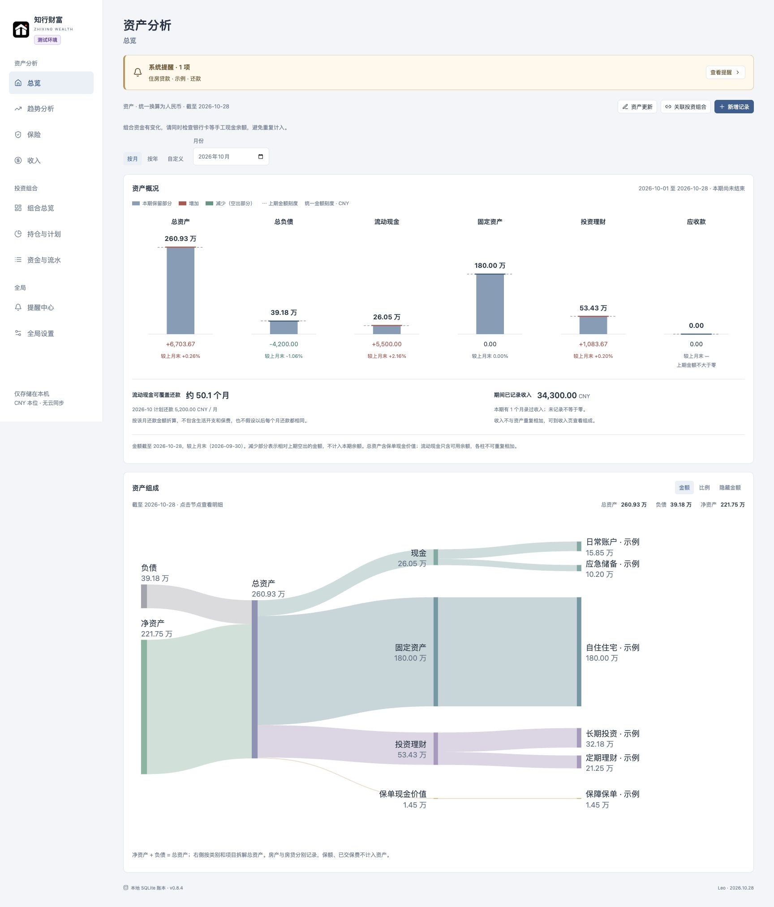
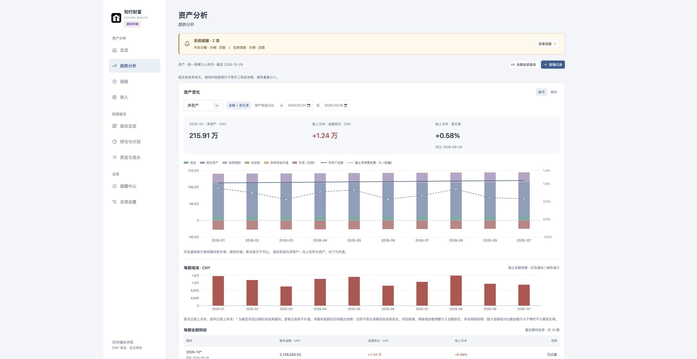
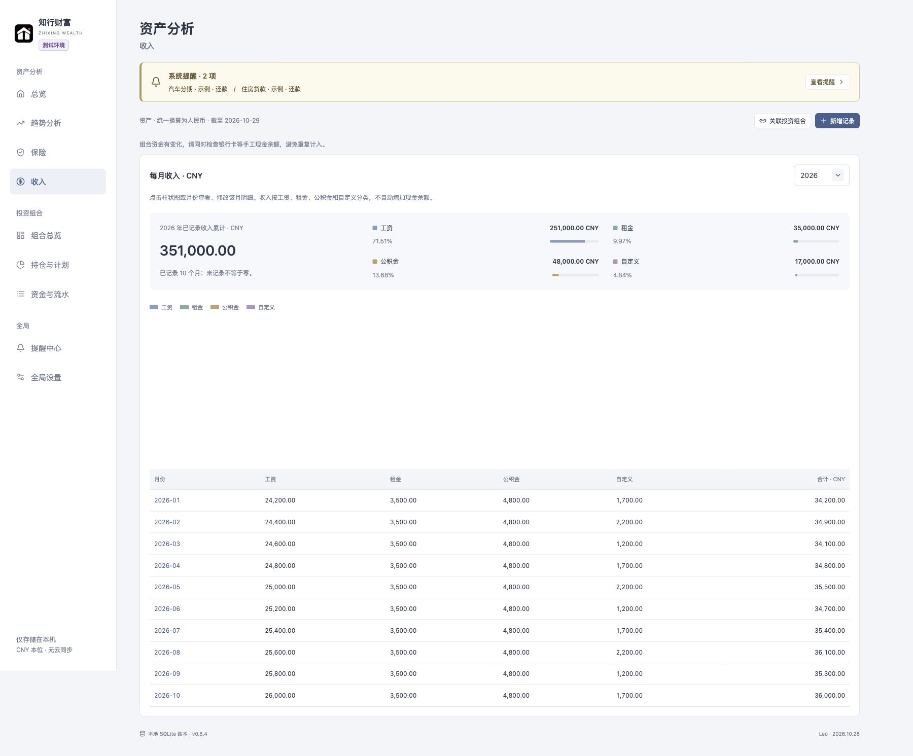
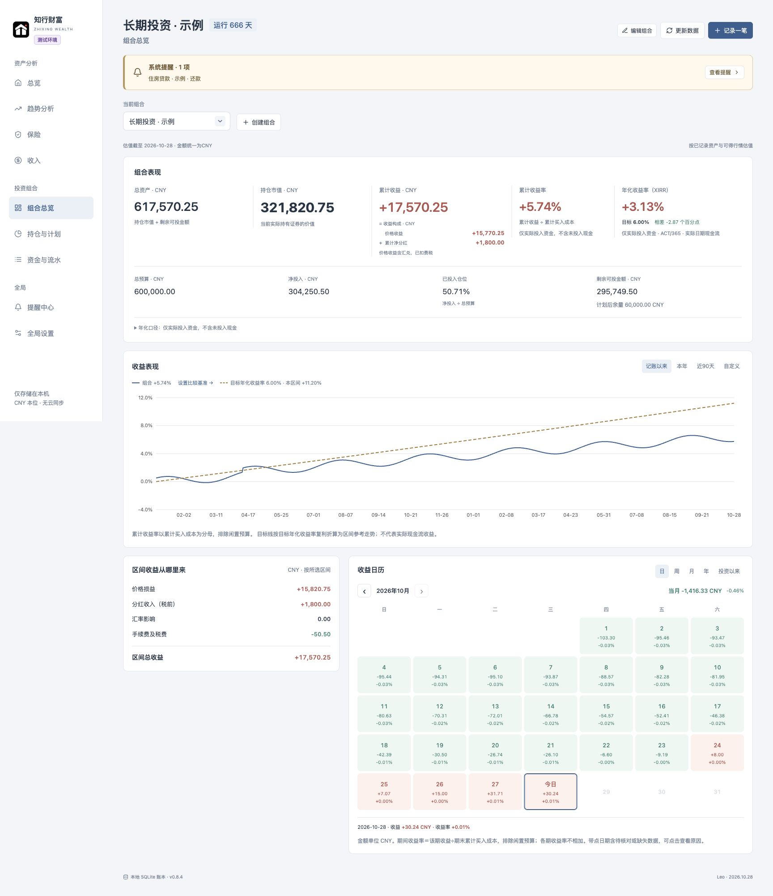
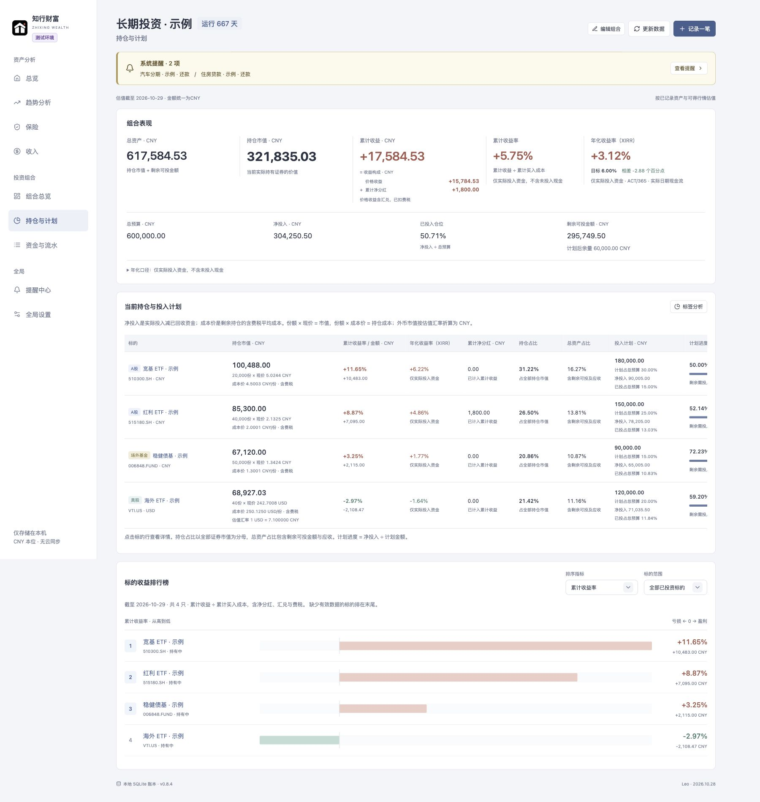
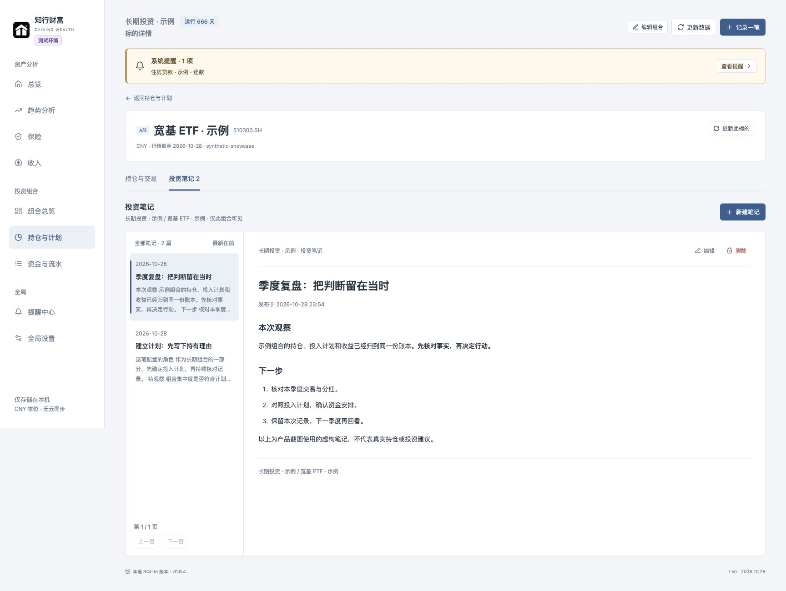

<p align="center">
  
</p>

# 知行财富 · Zhixing Wealth

**把财富看清，把投资记明白，把日常整理交给 Agent。**

知行财富是一套本地运行、与 Agent 原生协作的个人与家庭财富管理系统。把银行卡、房产、负债、基金股票和投资笔记连成一份完整档案：打开界面，看清资产和收益；说出任务，让 Agent 帮你查询、核对与记账。

**从“我大概有多少”，到“每一笔都说得清”。让记录越积累越有价值。**

**家庭资产全景 · 多市场投资组合 · 收益与计划 · Agent 原生协作 · 数据本地保存**

[开始安装](docs/install.md) · [看看实际界面](#用几个页面看清你的财富) · [系统能力](#系统能做什么) · [Agent 原生协作](#让-agent-成为你的日常财富助手) · [计算与数据来源](docs/accounting.md)

当前源码版本 **0.8.5** · macOS / Linux · [Apache-2.0](LICENSE)

## 为什么值得拥有

银行卡、基金、股票、房产、保单分散在不同地方，想知道自己的资产全貌，往往要重新整理一遍表格。多次买卖、分红和再投之后，投入了多少、实际赚了多少，也未必能从一个账户的盈亏数字里看清。时间一长，连当初为什么买入都可能忘记。

知行财富希望把这些事情连起来，让财富管理成为可以持续积累的日常习惯。

- **看全局，也能追到每一笔。** 从家庭资产变化，到组合收益，再到交易、费税和笔记，逐层核对自己的记录。
- **把重复整理交给 Agent。** 用自然语言查询、更新余额、维护投资记录，把精力留给核对事实和做决定。
- **让今天的记录，成为未来的依据。** 保存历史快照、交易修订和笔记版本，回头看时既有数字，也有当时的思考。
- **掌握自己的数据和工具。** 本机运行，源码开放，支持导出与完整备份；可以了解计算规则，也可以按自己的需要扩展。

如果你在长期投资、同时管理多个市场的持仓，或者希望认真整理个人与家庭资产，这套系统就是为这样的日常准备的。

## 用几个页面，看清你的财富

> 以下均为实际界面截图，使用独立生成的**合成示例数据**。金额、行情、收益和笔记均为虚构，不能代表真实证券表现；首次安装仍是空账本。[截图来源与重建方法](docs/showcase.md)

### 资产全景：先看清自己拥有什么

现金、房产、投资、负债和保单现金价值放在同一张图里。从总资产到分类，再到每个项目，顺着构成图就能看到资金分布；同时查看上期增减、期间收入和现金可覆盖的还款月数。



### 历史趋势：让每次余额更新留下痕迹

资产记录按日期积累成月度、年度趋势。分类堆叠展示资产结构，负债单独扣除；按月比较上月末、按年比较上年末，配合每期增减柱形，帮助你看清财富如何变化。资产变化与投资收益分开，避免把新增收入误当成投资赚到的钱。



### 收入组成：看见每一份积累

这一年已经记录了多少收入，工资、租金、公积金和其他收入各占多少？累计金额与一条彩色横条放在月度图表之前，各类收入占比一眼可比，点击月份即可追到明细。收入记录和资产余额分开核对，不重复计入财富。



### 组合收益：投入多少、赚了多少，放在一起核对

总预算、净投入、持仓市值、累计收益和 XIRR 各有位置。收益曲线、收益构成与日历把长期结果拆回可以理解的日常记录，分红、费用和汇兑影响也有迹可循。送转股、拆股可按公告核对份额，保留原买入总成本；价格图提供复权参考，避免把除权跳变误读为投资亏损。



<details>
<summary><strong>展开查看：持仓、投入计划与标的收益排行</strong></summary>

看持仓，也看计划。多市场、多币种的标的集中展示，查看累计收益、年化、净分红与投入进度，核对剩余资金是否够用。宽表可横向滚动查看完整计划和操作列。



</details>

### 投资笔记：给数字留下当时的理由

把持有逻辑、观察和复盘写在对应组合与标的下。交易记录告诉你“发生了什么”，笔记帮你保留“当时为什么这样想”。支持 Markdown 阅读和历史版本，也可以让 Agent 按你的授权整理保存。



## 系统能做什么

| 能力 | 你可以怎样使用 |
|---|---|
| **家庭资产全景** | 管理现金、固定资产、投资理财、应收款、负债与保险，查看资产分类、构成及变化；投资组合可关联到资产总览。 |
| **历史与趋势** | 按日期追加余额快照，查看月度、年度及自定义区间，比较上期金额增减与变化率；补录历史保留后续余额。 |
| **多市场投资组合** | 管理 A股、港股、美股股票／场内 ETF，以及境内场外基金；多个组合独立记录，支持 CNY、HKD、USD。 |
| **买卖、分红与再投** | 记录成交、份额和费税，按批次卖出；核对现金分红和红利再投。场外基金可用所选日净值估算再投份额，并保留人工核对结果。 |
| **收益与投入计划** | 查看持仓市值、累计收益、净分红、XIRR、收益日历和标的排行；设置投入计划、查看资金缺口，用主题、资产类别和地区标签分析分布。 |
| **收入、还款与保险提醒** | 按月记录工资、租金、公积金等收入，设置还款和保费计划，集中查看待办；macOS 可启用系统通知。 |
| **投资笔记与历史追溯** | 在指定组合和标的下保存 Markdown 笔记，保留历史版本；查看交易修订，回顾决策背景。 |
| **行情、导入导出与备份** | 同步行情、净值、汇率和分红公告；CSV 预览与导入、流水导出，以及包含数据库和笔记历史的完整 ZIP 备份。 |

### 收益，值得算得更明白

知行财富把总预算、净投入、累计买入成本和持仓市值分开展示，帮助你区分“计划投多少”“已经投了多少”和“现在值多少”。

- **年化收益率用实际日期现金流计算 XIRR**，不把尚未投入的预算算成投资本金。
- **收益包含费税、分红和汇兑的影响**，并展示收益构成，便于核对。
- **交易汇率按笔锁定**，后续行情更新不会覆盖历史交易使用的汇率。
- **缺数据就显示未知**；未核对的分红公告不会直接计入收益，缺少当日净值也不会借用其他日期来估算再投份额。

计算方式、行情口径和覆盖限制都可以在 [计算与数据来源](docs/accounting.md) 中查阅。

## 让 Agent 成为你的日常财富助手

**同一份账本，两种使用方式：你可以在界面里操作，也可以把明确的任务交给 Agent。**

知行财富为 Agent 提供结构化 API、能力发现、操作技能和本地客户端。界面与 Agent 共用同一套后端计算、业务校验和修订记录，Agent 可以读取真实账本、解释结果，并在你的授权范围内完成操作。

安装后，在独立的日常工作目录中，你可以这样说：

> “查看我这个月的资产变化，按类别列出增减，并区分余额变化和投资收益。”

> “把‘工资卡’今天的余额更新为 28,000 CNY，这是完整余额。先给我看预览。”

> “核对‘长期投资’组合的投入计划，告诉我各标的还需要投入多少、剩余可投金额是否够用。”

> “把下面这段投资逻辑存为‘长期投资’组合中这只基金的投资笔记，先让我核对标题和正文。”

这些是使用示例，名称与金额需要换成你自己的信息；首次安装不会创建这些记录。任务中缺少目标、日期或必要字段时，Agent 应先核对。

### 从安装到日常使用，都有明确指引

仓库内的 [AGENTS.md](AGENTS.md) 负责区分安装、升级、开发和日常使用；[安装指南](docs/install.md) 帮助 Agent 建立正式运行环境和独立的日常目录。日常入口 `./zhixing` 跟随当前正式版本，校验服务环境与账本目录，减少误连开发账本的可能。

三项随项目提供的技能覆盖主要操作：

- [资产管理 · zhixing-assets](.agents/skills/zhixing-assets/SKILL.md)：资产查询、余额快照、负债、保险、收入与组合关联。
- [组合记账 · zhixing-portfolios](.agents/skills/zhixing-portfolios/SKILL.md)：持仓、买卖分红、红利再投、投入计划与收益核对。
- [投资笔记 · zhixing-notes](.agents/skills/zhixing-notes/SKILL.md)：读取、新建、修改、删除及撤销删除指定组合与标的的笔记。

### 每次操作，都能核对前因后果

1. **先读账本**：确认真实对象、日期、币种和当前版本。
2. **展示改动**：交易和资产操作走预览；组合资料、笔记等没有预览接口的操作展示拟保存内容或差异。
3. **按授权提交**：携带刚核对的修订号；账本已变化时返回冲突，要求重新读取核对。
4. **保存后回读**：核对实际落账结果；超时或结果不确定时先查证，避免重复写入。

你需要使用能够读取项目文件、执行本地命令或访问本机 HTTP 的 Agent。系统提供接入能力，自身不内置聊天模型；不同 Agent 的技能发现方式见 [AI 接入说明](docs/ai.md)。

<details>
<summary>给 Agent 与工具开发者：接入入口</summary>

- `GET /api/capabilities`：发现当前能力、鉴权方式、并发与分页约定。
- `GET /api/openapi.json`：读取机器可读的接口契约。
- `GET /api/family/command-schema`：读取资产操作结构与语义。
- [scripts/ai_client.py](scripts/ai_client.py)：使用 Python 标准库的客户端，处理会话、CSRF、目标环境校验与明确的写入确认。
- [API 文档](docs/api.md)：字段、预览、提交、回读、错误及范围约束。

通过本机 HTTP 即可接入，无需额外部署 MCP 服务；业务操作通过 API 执行。

</details>

## 本地保存，长期积累

财富管理需要持续使用，记录也需要经得起升级和迁移。

- **账本与笔记保存在本机。** 数据库使用 SQLite，笔记正文使用 Markdown；无需注册本产品的云端账号。
- **首次安装从空账本开始。** 不携带作者账本或 demo 数据；测试使用独立的合成数据。
- **完整备份覆盖历史。** 数据库、被引用的笔记正文与历史版本一起备份，并校验内容；恢复前保留原账本备份。
- **升级有数据保护流程。** 停写、备份最新数据、隔离演练、比对既有记录与笔记、只读验收，通过后才开放业务。不一致时保留阻断记录与备份，等待核对。
- **开发和日常使用分开。** 开发、测试、正式环境各自使用独立数据目录；发布权限不包含更改正式业务记录。

行情请求只发送代码、日期与币种。使用云端 Agent 时，Agent 读取的账本信息仍按该 Agent 的数据处理规则流转；本地保存与 AI 服务的数据处理是两个环节。

## 开始使用

### 交给 Agent 安装

下载或克隆本仓库，将源码放在独立目录，然后把下面这段话交给你的 Agent：

> 请先读取本仓库的 AGENTS.md 和 docs/install.md，核对我的操作系统、安装目录和既有安装。按指南安装知行财富正式版，并创建独立的日常使用目录。首次安装应为空账本；如果已有数据，按升级流程保全数据。完成后告诉我如何启动、停止，以及进入哪个目录进行日常操作。

完整步骤见 **[安装、升级与 Agent 交接](docs/install.md)**。首次安装需要 Python 3.11+、Node.js 20.19+、npm；macOS 准备正式发布包还需要 Xcode Command Line Tools。

安装后，从自己的第一笔记录开始：建立资产台账或投资组合，录入余额与交易，再查看总览、收益和计划。你可以一直使用界面，也可以随时让 Agent 接手明确的日常任务。

### 使用范围

当前提供 macOS / Linux 的本机单用户运行流程，Windows 原生运行未验证。正式服务默认只监听 `127.0.0.1:8765`，不提供云同步或多人共享访问。Linux 可使用页面提醒；macOS 可使用系统通知。

知行财富用于记录、核对和回顾，不连接券商下单，也不自动执行投资决策。行情依赖外部数据源，可能限流或缺失；自动分红、再投估算及跨市场企业行动应与实际凭证核对。分红复核支持保留实际到账并结束核对，原流水保持原样；权益或公告实质变化仍会提醒。

## 开发与贡献

**React + TypeScript · FastAPI · SQLite · Alembic**

欢迎通过本仓库的 Issues 分享使用场景、反馈问题，或提交 Pull Request。涉及新功能时，请同时考虑界面操作和 Agent 接口，让两种入口使用相同的规则。

开发遵循 **需求分支 → 开发与测试 → PR / MR → review 与合并 → 从 master 部署**。主分支不直接开发、提交或推送；合并后从干净且与远端一致的 `master` 重新构建和验证，再按数据保护流程部署。[完整开发流程](docs/development.md)

<details>
<summary>本地开发与验证命令</summary>

先按 [开发流程](docs/development.md) 从最新 `master` 创建需求分支，再在源码根目录执行：

```sh
python3 -m venv .venv
.venv/bin/python -m pip install -r requirements.lock.txt
npm --prefix frontend ci
npm --prefix frontend run build
.venv/bin/python scripts/manage.py init --environment dev
.venv/bin/python scripts/manage.py start --environment dev --open
```

开发服务为 `http://127.0.0.1:8877`；前端热更新使用 `npm --prefix frontend run dev`，仅代理开发后端。固定端口冲突时会报错。

完整合成回归：

```sh
frontend/node_modules/.bin/playwright install chromium
.venv/bin/python scripts/verify.py --browser
```

Linux 浏览器运行依赖及完整安装要求见 [安装指南](docs/install.md)。自动验收使用带 `test` 标记的临时合成账本，测试端口为 8876，输出保存在源码目录之外。

提交边界仅限本源码目录。数据库、笔记、备份、日志、私人截图和本机配置不进入仓库；提交前运行 `scripts/source_check.py` 并人工复核。开发规范见 [AGENTS.md](AGENTS.md)。

</details>

## 继续了解

- [开发与审阅](docs/development.md)：需求分支、测试、PR 和 master 发布。
- [安装与升级](docs/install.md)：首次安装、日常目录、升级保护及失败处理。
- [AI 接入说明](docs/ai.md)：技能、客户端、授权与日常协作方式。
- [API 文档](docs/api.md)：接口能力、参数和调用流程。
- [计算与数据来源](docs/accounting.md)：收益、分红、行情口径与限制。
- [运行、发布与恢复](docs/operations.md)：环境管理、备份、迁移和维护。
- [设计规范](docs/design.md)：界面交互与统计规则。

## 作者与许可

作者：**Leo** · [GitHub @helei112g](https://github.com/helei112g)

源码采用 [Apache License 2.0](LICENSE)，Copyright 2026 Leo。第三方依赖与行情、指数、公告等数据遵循各自许可，源码许可不授予第三方数据的再分发权。

如果你也希望拥有一份看得清、能持续维护的财富档案，欢迎从这里开始。觉得有用，欢迎 Star，也欢迎把实际使用中的想法带回来。
